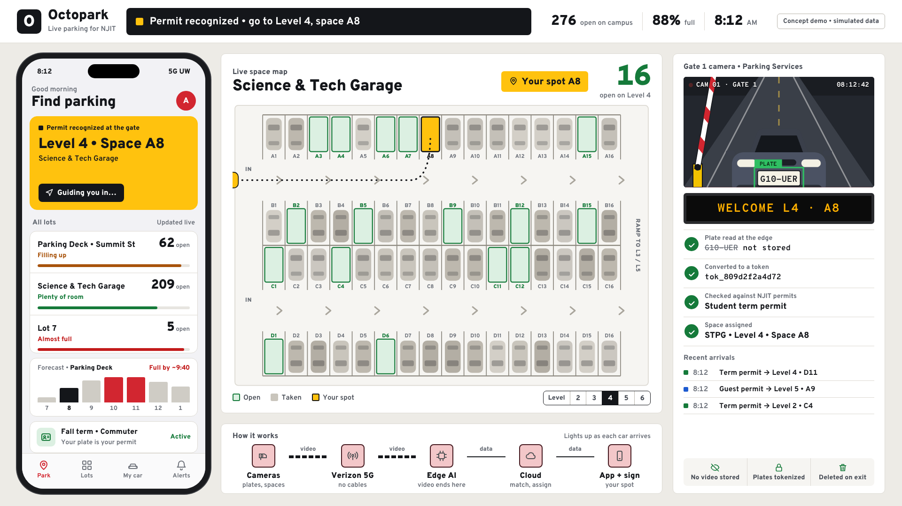

# Octopark — smart parking for NJIT

Our entry for the **2026 Verizon Smart Campus Innovation Challenge**.

This page explains the whole project in plain language. Read it once and you can explain the idea to a judge.

**Round 1 is a two-minute video, due November 12, 2026 at 11:59 p.m.**

## The problem

NJIT is a commuter campus. There are more parking permits than parking spaces, and nobody can tell which deck has room until they have already driven into it. So people circle, burn fuel, and walk into class late. Meanwhile Public Safety has no live picture of which cars are on campus.

## Our idea

Campus should already know where the open spots are and tell you before you choose a ramp.

1. **Cameras watch the lots.** Software looks at the video and marks every space as open or taken.
2. **A camera at the gate reads your license plate** and checks it against the plate you registered with NJIT when you bought your permit.
3. **The system assigns you a lot.** Your phone and a sign at the gate say, for example, "Level 3 — 42 open."
4. **Guests are recognized too.** When a guest has an approved pass — a host-arranged visit or a one-night guest permit — their plate is on the list, so the gate knows them and sends them to a level where they are allowed to park.
5. **Campus stays aware.** A car with no permit and no pass is not given a space, and the gate officer is alerted. Parking Services sees it; Public Safety is alerted only in cases a written policy allows.

## How NJIT parking works today, and what changes

| Today | With Octopark |
| --- | --- |
| Students pay for a parking permit by term and show a hang tag | The plate is the permit — nothing to hang, nothing to forget |
| You drive in and hunt for a space | You are told the level and space before you choose a ramp |
| Faculty and staff book guest parking online; guests of resident students get a one-night permit from Public Safety | Same approvals, but the guest's plate is added to the pass, so the gate recognizes the car |
| A guest stops at the garage gate and asks a Public Safety officer over the speaker to be let in | Approved guests are recognized automatically; the officer only handles the exceptions |
| Overnight parking (1–5 a.m. on weekdays) is allowed only on certain levels, checked by patrol | Overnight cars are sent to an allowed level, and a car parked where it should not be is flagged |

There is no pay-by-phone parking in NJIT lots. The meters on the streets around campus belong to the city and are not part of this system.

## How it works, step by step

```
Camera  ──▶  Verizon 5G  ──▶  Edge AI  ──▶  Parking service  ──▶  Your phone + gate sign
(sees cars)  (carries video)  (understands   (matches permit,     (tells you where
                              the video)     picks a lot)         to park)
```

- The **camera** only captures video.
- **5G** carries that video wirelessly, so nobody has to dig up the lots to lay cable.
- The **edge AI** is a computer close to campus that turns video into simple facts — "space C-14 is open," "a car with this permit just arrived." The video is thrown away right there.
- The **parking service** decides which lot has room for you.
- The **app and sign** show the answer in the few seconds it takes you to reach the gate.

## What we would install

| Hardware | Job |
| --- | --- |
| **Plate-reading cameras** at each entry and exit | Read the plate as a car comes in |
| **Overview cameras** in decks and on light poles | Let the AI see which spaces are open; one camera covers dozens of spaces |
| **Edge AI computer** (for example an NVIDIA Jetson) in each deck | Runs the AI on site so video stays local |
| **5G router** | Connects everything to Verizon's network without cables in the ground |
| **Entry sign** | Shows open counts at the gate |
| **Sensors** in a few spaces (optional) | Cover spots the cameras cannot see |

The **software** — the AI models, the database and the app — would most likely run on **AWS**. That fits well, because Verizon's edge computing is offered together with AWS. The exact architecture is **still to be decided**; the current draft and the open choices are in [docs/03-architecture-data-security.md](docs/03-architecture-data-security.md).

## Words you will hear

| Term | What it means here |
| --- | --- |
| **5G Ultra Wideband** | Verizon's fastest wireless network. Fast enough to carry many camera feeds at once. |
| **Edge computing** | Doing the computing near where the data is made (on or next to campus) instead of in a faraway data center. It gives faster answers and keeps video local. |
| **Private 5G** | A 5G network only campus devices can join. The cameras are never on the public internet. |
| **IoT** | "Internet of things" — small connected devices such as cameras, signs and sensors. |
| **Plate reader (ALPR / LPR)** | A camera plus software that reads the letters on a license plate. |
| **Token** | A scrambled code that stands in for your plate. The database stores the code, never the readable plate. |
| **Retention** | How long data is kept before it is deleted. |
| **AWS** | Amazon Web Services — rented cloud computers and databases. Where our software would run. |
| **Pillar** | One of Verizon's three focus areas. Every project must fit one; ours is **AI-Driven Automation & Efficiency**. |

## Who benefits

| Who | What they get |
| --- | --- |
| Students, faculty, staff | Minutes back every day and a known spot before arriving |
| Parking Services | Real numbers on how full each lot is; no more walking rows checking hangtags |
| Public Safety | A live picture of vehicles on campus |
| NJIT and Newark | Fewer cars idling in decks means less pollution |
| Verizon | A product it could sell to every commuter campus, hospital and stadium |

## How Verizon is used

- **5G Video Insights** is a Verizon product that makes ordinary cameras AI-enabled. It already includes a "parking occupancy" app, vehicle counting and automatic blurring, and it processes video on site. We would use it to see which spaces are open, and add the part Verizon does not have: matching the plate to a permit and assigning a space.
- **5G** connects the cameras without cables.
- **5G Edge** runs the AI close to campus so the answer arrives before the car reaches the gate.
- **Private 5G** keeps camera traffic off the public internet.
- **IoT tools** connect and manage the signs and sensors.

More detail: [docs/03-architecture-data-security.md](docs/03-architecture-data-security.md).

## Privacy and the law, in short

The first thing a judge will ask is "isn't this surveillance?" Our answer:

- It is for **parking only**. It is not used to track where a person goes.
- **Video never leaves the edge**, and it is not stored.
- **Plates are turned into tokens** before anything is saved.
- **Data is deleted when you drive out.**
- We only match against plates **people registered with NJIT themselves**. We never look anyone up in state motor-vehicle records.
- A person, not a camera, makes any decision about a ticket.

On the rules: New Jersey has strict rules for plate readers run by **police** — data kept three years and shared with a statewide police system. We deliberately have **Parking Services** run the system instead, so the data stays on campus and is deleted quickly. Federal student-privacy law (FERPA) also applies because a plate can be linked to a student.

Full research with sources: [docs/02-rules-and-regulations.md](docs/02-rules-and-regulations.md). It is student research, not legal advice.

## Questions a judge might ask

**Does this already exist?** Parts of it do. Some universities read plates in place of hangtags, and some garages count open spaces. Combining both on 5G with edge AI, and using it to assign you a lot at the gate, is the new part.

**What does it cost?** Cameras cover dozens of spaces each, so it is far cheaper than putting a sensor in every space. We would start with one deck for one semester. Rough numbers are in the pitch brief.

**What if the camera misreads a plate?** The app lets you check in manually, and no ticket is ever issued from a camera read alone.

**What if the network goes down?** Gates work the way they do today and the app says counts are unavailable. Nobody gets locked out.

**Did you build it?** Not yet. Round 1 is a concept pitch, and prototypes are not required and do not affect judging. The demo is a simulation that shows what it would look like.

## The video

Two minutes maximum — ours is timed to 1:55. It opens with real footage of circling a full deck, then a teammate talks to camera with the demo running behind them, then it closes on the driver walking into class on time.

Script, shot list and the plan for filming day: [docs/04-video-script.md](docs/04-video-script.md).

## Running the demo

1. Download or clone this repo and open `demo/index.html` in Chrome. No install needed.
2. Press `F11` for full screen.
3. Keys:

| Key | What happens |
| --- | --- |
| `Space` | A student with a term permit arrives and is guided to a space |
| `G` | A guest with an approved one-night permit arrives; the host's phone is notified |
| `V` | A car with no permit or pass arrives; the gate officer is alerted |
| `P` | Presenter mode: clears the bottom-left corner for a webcam bubble |
| `A` | Turns automatic arrivals on or off |
| `H` | Shows or hides a list of these keys (hidden by default, so it never appears on camera unless you press it) |
| `L` | Switches between three looks: signage (default), app and console |
| `S` | Story mode: the five demo moments of the video script, one at a time. The part being talked about comes to the front and zooms in, with a subtitle bar at the bottom |
| `→` / `←` | Next / previous story step. A presentation clicker (PageDown / PageUp) works too. `Esc` leaves story mode |

The full Octopark logo is in `demo/octopark-logo-full.png`. The demo header uses `demo/logo.png`, a square crop of just the octopus mark, because the wordmark would be too small to read at that size.

Add `?story` to the address to open straight into story mode. Add `?look=app` or `?look=console` to the address to start in one of the other looks. They are modelled on three kinds of real parking product: garage guidance signage (INDECT, Park Assist), consumer parking apps (SpotHero, ParkMobile) and operator software.

Add `?manual` to the end of the address to start with automatic arrivals off, so cars come only when you press a key.

The demo uses made-up plates and live counts. The lots and their sizes come from NJIT's own live parking page (see [docs/07](docs/07-existing-njit-parking-page.md)), and are set at the top of the script block in the file.



## Video pieces outside the demo

The script (docs/04-video-script.md) needs three things besides the demo itself:

- **Phone mode, for the 1:38 shot where the driver opens Octopark.** Open `demo/index.html?phone` on a real phone (put the `demo` folder on the phone, or host it). It shows just the app, full screen, on "Level 4 • Space D4, guiding you in". One tap switches to "You're parked". Add `&spot=B7` to show a different space.
- **Title cards, for 0:18 (THE CHALLENGE) and 1:38 (THE VALUE).** Ready-made 1920×1080 images are in `demo/cards/`. Each comes as a full-screen card (`challenge.png`, `value.png`) and as a transparent overlay to put over the filmed footage (`challenge-overlay.png`, `value-overlay.png`).
- **End card, for 1:50.** `demo/cards/end.png`. Put your names in `TEAM` at the top of the script block in `demo/cards.html`, open it in Chrome at full screen (`F11`) and take a 1920×1080 screenshot, or ask for a new export. The survey number the script mentions goes in `SURVEY` and then shows on the challenge cards.

`demo/opening.html` is an animated stand-in for the 0:00–0:10 ramp shot (a full garage level, a car circling, the clock going from 8:24 to 8:29), if there is no ramp footage. Reload it to replay.

`demo/cards.html` shows all the cards; `←` and `→` switch between them, and `?overlay` shows the transparent versions.

## What is in this repo

| File | What it is |
| --- | --- |
| [docs/01-pitch-brief.md](docs/01-pitch-brief.md) | The pitch: challenge statement, value proposition, pillar, how we score on the rubric, budget, risks |
| [docs/02-rules-and-regulations.md](docs/02-rules-and-regulations.md) | Federal, New Jersey and NJIT rules for plate readers and campus cameras |
| [docs/03-architecture-data-security.md](docs/03-architecture-data-security.md) | System design, how Verizon is used, what data is collected and how it is secured |
| [docs/04-video-script.md](docs/04-video-script.md) | The two-minute script, shot list and production plan |
| [docs/05-data-storage-and-security.md](docs/05-data-storage-and-security.md) | What is stored and for how long, and what that does and does not give campus security |
| [docs/06-new-jersey-law.md](docs/06-new-jersey-law.md) | How the storage and sharing design fits New Jersey law |
| [docs/07-existing-njit-parking-page.md](docs/07-existing-njit-parking-page.md) | How NJIT's current live parking page gets its numbers, where they go wrong, and how we answer "doesn't this already exist?" |
| [docs/08-stitch-prompt.md](docs/08-stitch-prompt.md) | A prompt for Google Stitch, if you want it to try its own design of the demo screen |
| [demo/index.html](demo/index.html) | The animated concept demo for the video |

## Before we submit

- [ ] Find out where the video is uploaded. The competition page says teams "will upload their video submission" online but gives no link or file format. Check the registration email or ask Dina Anello at Ying Wu College of Computing (contact on the competition page).
- [ ] Replace the numbers marked **verify** in the pitch brief with current ones from Parking Services, or with our own survey of classmates.
- [ ] Video is 2:00 or under, and states the challenge and the value proposition.
- [ ] AI use is allowed, but the competition page says to "be prepared to discuss how it was used" and to consider noting where it helped. Add a short credit at the end for any AI voice, AI images, the logo if AI helped make it, and the demo (built with help from an AI coding assistant), and be ready to explain it.

## Competition facts

- Teams of 3–6. Judged on impact, feasibility, creativity, content and presentation. The page gives no weights, only a Low / Medium / High guide; "High" content is "backed by data, research, or real-world validation".
- Projects must align with one of Verizon's three pillars, named exactly: **AI-Driven Automation & Efficiency** (our headline), **Cost & Sustainability Transformation**, and **Next-Gen Products & Services to Enhance Customer Experience**.
- The page encourages "innovative use of Verizon's 5G" and lists, among others, Multi-access Edge Computing, Private 5G with MEC, AWS Wavelength on Verizon 5G Edge, network slicing and C-V2X. None is required.
- Round 1 accepts any creative format, for example "PowerPoint with voiceover" or a presenter talking to camera. Prototypes "are not required and will not affect the judging evaluation."
- Round 2 is a poster showcase on February 11, 2027. Round 3 is a presentation on March 2, 2027. Teams that reach Round 3 get $500. Three winning teams get $3,000 each and present at Verizon headquarters on March 30, 2027. The page is inconsistent on Round 3 length (5 or 10 minutes).
- Details: [NJIT Smart Campus page](https://computing.njit.edu/smart-campus).
