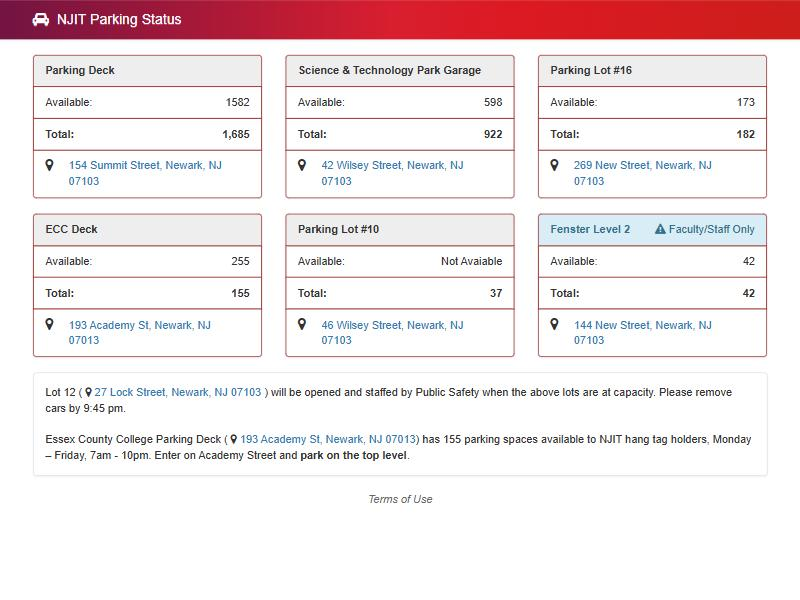

# NJIT's existing parking page, and why it is wrong

NJIT already publishes live parking counts at [mobile.njit.edu/parking](https://mobile.njit.edu/parking/). A judge may ask, "Doesn't this already exist?" This page explains how NJIT's page works, shows where it breaks, and gives our answer.

Everything here was checked on **November 11, 2026 at about 12:30 a.m. ET** by opening the public page and reading the data it loads. Nothing needed a login. A screenshot from that time is below.

A second, high-resolution capture from **11:08 p.m. the same night** shows the ECC Deck at **212 available out of 155**: [img/njit-parking-page-2026-11-11-2308.png](img/njit-parking-page-2026-11-11-2308.png). The music-only ad (`demo/ad.html`) uses this one, because it stays sharp when zoomed in.

## How the page gets its numbers

The page is a small AngularJS web app. It calls two endpoints on NJIT's server:

| Endpoint | What it returns | How often |
| --- | --- | --- |
| `POST /parking/data.php` | For each lot: `Available`, `Occupied`, `Total`, name, address, and a type (`general`, `facstaff`, `reserved`) | Every 30 seconds |
| `POST /parking/details.php` with `{"deck": "<SiteName>"}` | **Average occupancy every 10 minutes**, 7:30 a.m. to 10:50 p.m., for one lot | When someone taps a lot's name, which opens a chart most people never find |

Each lot also carries internal fields: `EngineName: "NJIT"`, a `SiteName` such as `PARK`, `ECC`, `FENS1` or `Lot 10`, and a description ending in "Facility".

**What is behind it (our inference):** a **gate counter**. It adds one when a car enters, subtracts one when a car leaves, and shows Available as Total minus Occupied. Nothing looks at individual spaces. The evidence is below: negative occupancy, a count that keeps climbing, and sudden jumps all happen with counters and cannot happen with a system that looks at spaces. We could not see which vendor's system it is.

## The lots it covers

| Name on the page | SiteName | Total spaces | Shown? |
| --- | --- | --- | --- |
| Parking Deck (154 Summit St) | `PARK` | 1,685 | Yes |
| Science & Technology Park Garage (42 Wilsey St) | `Science & Tech Garage` | 922 | Yes |
| Parking Lot #16 (269 New St) | `Lot 16` | 182 | Yes |
| ECC Deck (193 Academy St) | `ECC` | 155 (NJIT's share) | Yes |
| Parking Lot #10 (46 Wilsey St) | `Lot 10` | 37 | Yes |
| Fenster Level 2 (144 New St) | `FENS2` | 42, faculty and staff only | Yes |
| Fenster Level 1 (142 New St) | `FENS1` | 42, reserved | **Hidden** |

The visitor lot, Lot 7, is not on the page.

Two numbers don't match ours: the page counts **922** spaces in the Science & Technology garage, while [01-pitch-brief.md](01-pitch-brief.md) cites **981** from NJIT Campus Planning. The pitch brief also puts the garage at 46 Wilsey Street, but this page uses 42 Wilsey for the garage and 46 Wilsey for Lot 10. **Check both with Parking Services before putting them on screen.**

## Where it breaks

"Occupied" is how many cars the counter thinks are inside.

| Lot | What the data showed | What it means |
| --- | --- | --- |
| **ECC Deck** | Occupied **−100**, so the page shows **255 available out of 155 total** | An impossible number, live on the page |
| **Parking Deck (Summit St)** | Average occupancy falls below zero every evening, reaching **−62** by 10:50 p.m. | More exits counted than entries. The count is off by dozens of cars a day. |
| **ECC Deck** (history) | Average falls to **−75** by evening | Same drift |
| **Lot 10** | 37 spaces, **58 occupied**, page says "Not Avaiable" (their typo). Its history climbs from **702 to 749** across the day. | The counter hasn't been reset properly in a long time, so the lot always looks full |
| **Fenster Level 1** | Exactly **22** cars at every 10-minute mark of the day | A stuck sensor. The lot is hidden on the page anyway. |
| **Science & Technology garage** | Average drops from **848 to 572** between 10:00 and 10:10 a.m. | Someone corrected or reset the count partway through the day |

The underlying problem: a gate counter only knows the difference between entries and exits. Every missed car, tailgating car or double-counted car stays in the number until someone resets it by hand. It also can't tell you which level or space is open.

## What this means for our pitch

**"Doesn't this already exist?"** NJIT already wants live parking counts, which proves the need. Its current system shows the limit of counting at the gates:

| | NJIT's page today | Octopark |
| --- | --- | --- |
| How it counts | Entries minus exits at the gate | Cameras look at each actual space |
| When a car is missed | The error stays until someone resets the counter | The next camera frame corrects it |
| Detail | One number per lot | Level and space |
| Tells you where to go | No | Yes, at the gate and on your phone |
| Recognizes your permit | No | Yes, plate matched to permit |

A line for the video: *"NJIT already tries to count cars, and tonight its own page says one deck has more open spaces than it has spaces."* Use the screenshot above as proof.

**Use the averages carefully.** The Summit Street deck's average occupancy peaks at about **1,045 of 1,685 (62%)** around 11:30 a.m. A judge could read that as "the decks aren't full." Our answer: the counter undercounts by dozens of cars a day, so its averages can't be trusted either way. Don't put that number on screen.

**A source of real data.** The 10-minute averages show when each lot fills (for example, Lot 16 goes from 22 to 172 cars between 7:30 and 10:10 a.m.). If we use them on the poster in Round 2, label them as NJIT's own counter data, which drifts.

## Notes

- The page is public and needs no login. If anyone collects data from it, keep requests rare — the page itself only asks once every 30 seconds — and don't build anything that depends on it.
- What's behind the page is our inference from the data, not something NJIT has told us. Ask Parking Services what system it uses. It's a good question for the mentors too.
